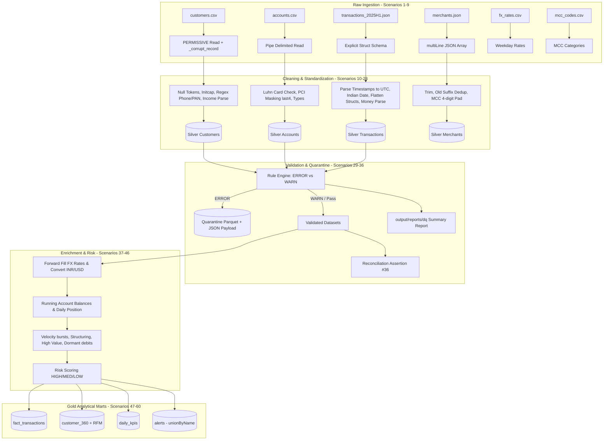

# NovaPay Bank — PySpark Transformations Masterclass
**Project 2 | Core PySpark | Data Engineering**

Production-grade PySpark end-to-end data pipeline processing realistic, messy bank data in CSV and JSON formats: cleaned, validated with a data-quality rule engine, quarantined with audit reasons, enriched with banking business rules (FX, account balances, fraud & AML risk scoring), and curated into Gold analytical models.

---

## Architecture Diagram



---

## Directory Structure

```
novapay-pyspark/
├── data/                                  # Input datasets
│   ├── customers.csv                      # Customer master (5,260 lines)
│   ├── accounts.csv                       # Account master (7,824 lines, pipe-separated)
│   ├── fx_rates.csv                       # Weekday FX rates (645 lines)
│   ├── mcc_codes.csv                      # Merchant category codes (20 lines)
│   ├── merchants.json                     # Merchant multi-line array (207 records)
│   └── transactions/
│       ├── transactions_2025H1.json       # 53,778 transaction records
│       └── transactions_2025-07-01.json   # 3,320 next-day records (schema drift)
├── src/
│   ├── __init__.py
│   ├── session.py                         # SparkSession initialization (#1)
│   ├── schemas.py                         # Explicit schemas (#2, #4, #5, #6, #7)
│   ├── transforms.py                      # Reusable transformation library (#8, #10-#29, #34, #35)
│   ├── read_clean.py                      # Ingestion & Silver layer transformations (#2-#28)
│   ├── validate.py                        # Validation rules, anti-joins, refunds (#29-#34)
│   └── business_gold.py                   # Business logic, FX, risk, analytics & Gold (#37-#57)
├── tests/
│   ├── __init__.py
│   └── test_transforms.py                 # Pytest test suite for transformation functions (#60)
├── output/                                # Pipeline outputs (git-ignored)
│   ├── silver/                            # Deduplicated, typed Silver Parquet tables
│   ├── quarantine/                        # Corrupt and ERROR-quarantined records
│   ├── reports/                           # Data quality reports
│   └── gold/                              # Analytical fact, dimension, KPI, and alert tables
├── run_pipeline.py                        # Main end-to-end pipeline runner
├── requirements.txt                       # Project dependencies
├── pytest.ini                             # Pytest configuration
├── .gitignore                             # Git exclusion rules
└── README.md                              # Project documentation
```

---

## All 60 Scenarios Implementation Mapping

| # | Phase | Scenario Title | Implementation File & Function | Expected Result (PDF Section 12) |
|---|---|---|---|---|
| **1** | Ingestion | SparkSession for this project | `src/session.py:get_spark_session` | UTC timezone, 8 shuffle partitions, CORRECTED time parser |
| **2** | Ingestion | Read messy CSV safely (string schema + corrupt record) | `src/read_clean.py:read_and_clean_customers` | 5,260 read, 30 corrupt captured |
| **3** | Ingestion | Split corrupt rows into quarantine | `src/read_clean.py:read_and_clean_customers` | 30 lines in `output/quarantine/corrupt_customers`, 5,230 continue |
| **4** | Ingestion | Read pipe-delimited CSV | `src/read_clean.py:read_and_clean_accounts` | 7,824 rows, 0 corrupt |
| **5** | Ingestion | Read nested JSON lines with explicit schema | `run_pipeline.py` & `src/schemas.py` | 53,778 records, 45 corrupt lines captured |
| **6** | Ingestion | Read multi-line JSON array with nested arrays | `src/read_clean.py:read_and_clean_merchants` | 207 merchants read without corruption |
| **7** | Ingestion | Detect schema drift in new file | `run_pipeline.py` / `src/schemas.py` | New columns detected (`fee`, `risk_score`) |
| **8** | Lineage | Add lineage columns (`_source`, `_loaded_at`, `_source_file`) | `src/transforms.py:add_lineage` | Lineage columns appended |
| **9** | Profiling | Profile before cleaning (nulls & distinct counts) | `run_pipeline.py` / profiling helper | 12 gender spellings, 13 txn_type spellings |
| **10** | Cleaning | Normalise null tokens in every text column | `src/transforms.py:normalise_nulls` | Null tokens (`N/A`, `null`, `-`, etc.) replaced with real `NULL` |
| **11** | Cleaning | Trim and fix casing | `src/read_clean.py:read_and_clean_customers` | Whitespace trimmed, names initcapped, PAN uppercased |
| **12** | Cleaning | Standardise categories with mapping tables | `src/transforms.py:map_values` | Clean mapped values; 51 unknown gender records mapped to `U` |
| **13** | Cleaning | Parse dates written in four formats | `src/transforms.py:parse_date` | 13 unparseable dates become `NULL` |
| **14** | Cleaning | Normalise timestamps from four styles to UTC | `src/transforms.py:parse_txn_ts` | 20 invalid timestamps remain `NULL` |
| **15** | Cleaning | Parse money (commas, Indian lakh grouping, symbols, negatives) | `src/transforms.py:parse_amount` | 65 unparseable income values become `NULL`, negative values correctly signed |
| **16** | Cleaning | Normalise percentages and booleans | `src/transforms.py:parse_percent` | Interest rates standardized, active booleans mapped |
| **17** | Cleaning | Clean phone numbers with regex | `src/read_clean.py:read_and_clean_customers` | 172 invalid phone numbers set to `NULL` |
| **18** | Privacy | Validate & mask card numbers (Luhn) without UDF | `src/read_clean.py:read_and_clean_accounts` | 1,829 valid cards, 99 failing Luhn; full PAN dropped, `card_last4` kept |
| **19** | Cleaning | Standardise accounts and transactions | `src/read_clean.py:read_and_clean_accounts` | Clean types, uppercase statuses |
| **20** | Nested Data | Flatten nested structs recursively | `src/transforms.py:flatten` | Nested merchant/location structs converted to top-level columns |
| **21** | Arrays | Work with arrays (flags, counts, explode) | `src/transforms.py` & `src/read_clean.py` | 1,049 international transactions flagged |
| **22** | Cleaning | Clean merchant data inside transactions | `src/read_clean.py:clean_transactions` | 226 invalid MCC codes flagged and nulled |
| **23** | Dedup | Remove exact duplicates | `src/read_clean.py` | 349 exact duplicate transactions & 80 customers removed |
| **24** | Dedup | Keep latest version per business key (`row_number`) | `src/transforms.py:latest_by_key` | 52,885 txns, 5,000 customers, 7,774 accounts |
| **25** | Dedup | Clean merchant master | `src/read_clean.py:read_and_clean_merchants` | 207 → 201 merchants deduplicated (removing `(old)`) |
| **26** | Derived | Derive new columns (`age`, `tenure`, `email_domain`, `pan_type`) | `src/read_clean.py:read_and_clean_customers` | Deterministic metrics calculated against `AS_OF = 2025-07-01` |
| **27** | Segmentation | Business segments with CASE logic | `src/read_clean.py` | Income bands (`MASS`, `AFFLUENT`, `HNI`, `ULTRA_HNI`) & account age |
| **28** | Silver | Package Saturday functions and write Silver | `src/read_clean.py` / `run_pipeline.py` | Partitioned Silver Parquet written |
| **29** | Validation | Reusable data-quality rule engine | `src/transforms.py:apply_rules` & `src/validate.py` | 67 `ERROR:age_18_plus`, 193 `WARN:email_format` |
| **30** | Validation | Cross-field rules for accounts | `src/validate.py:validate_accounts` | 12 closed before open, 97 card Luhn failures |
| **31** | Referential Integrity | Referential integrity with anti-joins | `src/validate.py:validate_accounts` | 45 orphan accounts, 60 orphan transactions |
| **32** | Validation | Transaction rules needing account | `src/validate.py:validate_transactions` | 1,378 txns after account closed, 100 non-positive amounts |
| **33** | Validation | Validate refunds against original transaction (self-join) | `src/validate.py:validate_transactions` | 42 refunds missing original, 29 exceeding original |
| **34** | Quarantine | Route rows by severity: quarantine vs Silver | `src/transforms.py:route` | Valid: 4,933 cust, 7,622 acc, 51,187 txns |
| **35** | Quality Ops | Data-quality summary report | `src/transforms.py:dq_summary` | Single summary CSV written to `output/reports/dq` |
| **36** | Reconciliation | Reconcile: No row may vanish | `run_pipeline.py` | `53,778 = 45 corrupt + 848 duplicates/old + 1,698 quarantined + 51,187 valid` |
| **37** | Business Rules | Clean FX rates and forward-fill gaps | `src/business_gold.py:enrich_fx` | 184 calendar days filled per currency |
| **38** | Business Rules | Convert every amount to INR and USD | `src/business_gold.py:enrich_fx` | 0 transactions without an FX rate |
| **39** | Business Rules | Signed amounts and money-movement direction | `src/business_gold.py:apply_business_rules` | Direction `IN`/`OUT` and signed INR amounts derived |
| **40** | Enrichment | Enrich with MCC reference (broadcast join) | `src/business_gold.py:apply_business_rules` | Broadcast join with fallback category enrichment |
| **41** | Balances | Running balance and daily closing position | `src/business_gold.py:apply_business_rules` | Running net INR position and closing daily balance |
| **42** | Fraud | Velocity bursts: many card txns in 10 minutes | `src/business_gold.py:apply_business_rules` | 20 accounts flagged |
| **43** | AML | Structuring just below reporting threshold | `src/business_gold.py:apply_business_rules` | 24 accounts flagged |
| **44** | AML | High-value, high-risk merchants and odd hours | `src/business_gold.py:apply_business_rules` | High value, high-risk MCC, round amount, odd hours flagged |
| **45** | Fraud | Dormant accounts moving money | `src/business_gold.py:apply_business_rules` | 2,963 debits on dormant accounts flagged |
| **46** | Risk Scoring | Combine flags into weighted risk score | `src/business_gold.py:apply_business_rules` | 359 HIGH, 7,049 MEDIUM risk transactions |
| **47** | Analytics | Customer 360: aggregates per customer | `src/business_gold.py:compute_analytics` | 4,933 customer rows |
| **48** | Analytics | Favourite category per customer (rank inside groups) | `src/business_gold.py:compute_analytics` | Deterministic favourite category per customer |
| **49** | Analytics | Monthly spend matrix (pivot) | `src/business_gold.py:compute_analytics` | Months `2025-01` to `2025-06` pivoted |
| **50** | Analytics | Unpivot back to rows (stack) & MoM change (lag) | `src/business_gold.py:compute_analytics` | 6 rows per customer with MoM % change |
| **51** | Analytics | RFM segmentation with `ntile` | `src/business_gold.py:compute_analytics` | 4 segments (`CHAMPION`, `AT_RISK`, `BIG_SPENDER`, `REGULAR`) |
| **52** | Analytics | Top 3 merchants per city (`dense_rank`) | `src/business_gold.py:compute_analytics` | 3 rows per city |
| **53** | Analytics | Totals and subtotals with `rollup` | `src/business_gold.py:compute_analytics` | Grand total and channel subtotals |
| **54** | Analytics | Explode, collect and structs in reverse | `run_pipeline.py` | Collect accounts array to JSON and explode back |
| **55** | Incremental | Day 2: schema drift + late data + replays | `run_pipeline.py` | Silver grows from 52,885 to 56,085 (320 late+replayed) |
| **56** | Gold Layer | Write Gold layer tables | `run_pipeline.py` | `fact_transactions`, `customer_360`, `daily_kpis` |
| **57** | Gold Layer | Unified alerts table (`unionByName`) | `run_pipeline.py` | Unified alerts queue across all 5 risk rules |
| **58** | Performance | Cache, broadcast and Catalyst plan inspection | `run_pipeline.py` | Verified `BroadcastHashJoin` execution plan |
| **59** | Performance | Python UDF vs built-in functions comparison | `run_pipeline.py` | Built-in JVM string functions outperform UDF |
| **60** | Unit Testing | Unit-test transformations with pytest | `tests/test_transforms.py` | 7 parametrized monetary tests passed green |

---

## Reconciliation Formula (Scenario #36)

The pipeline enforces mathematical completeness so that **no record can disappear silently**:

$$\text{Total Records Read} = \text{Corrupt Rows} + \text{Duplicates / Superceded Versions} + \text{Quarantined Rows} + \text{Valid Rows}$$

On the 2025H1 transactions dataset:
$$53,778 = 45 + 848 + 1,698 + 51,187$$

---

## How to Run

### Prerequisites
- Python 3.11+
- Java 17+ (`JAVA_HOME` pointing to JDK directory)

### 1. Setup Virtual Environment & Dependencies
```bash
python -m venv .venv
source .venv/bin/activate    # On Windows: .venv\Scripts\activate
pip install -r requirements.txt
```

### 2. Run the Unit Test Suite
```bash
pytest -v
```

### 3. Run the Full End-to-End Pipeline
```bash
python run_pipeline.py
```
